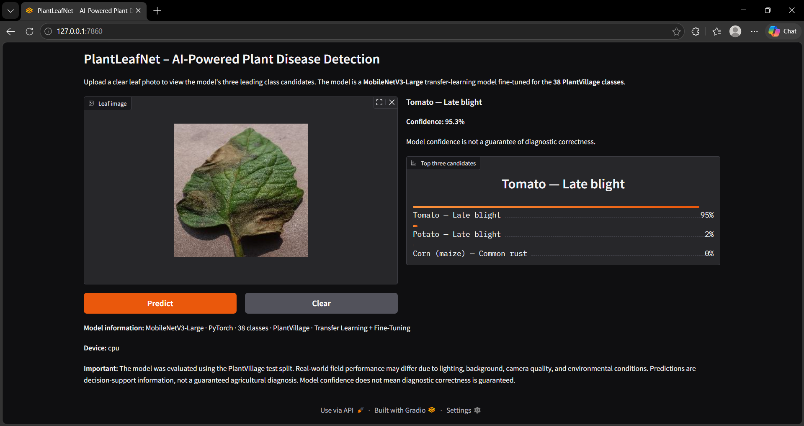
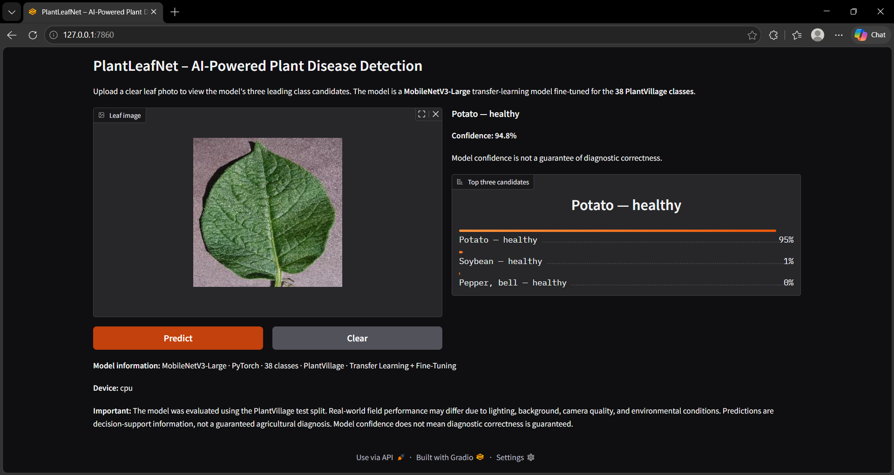
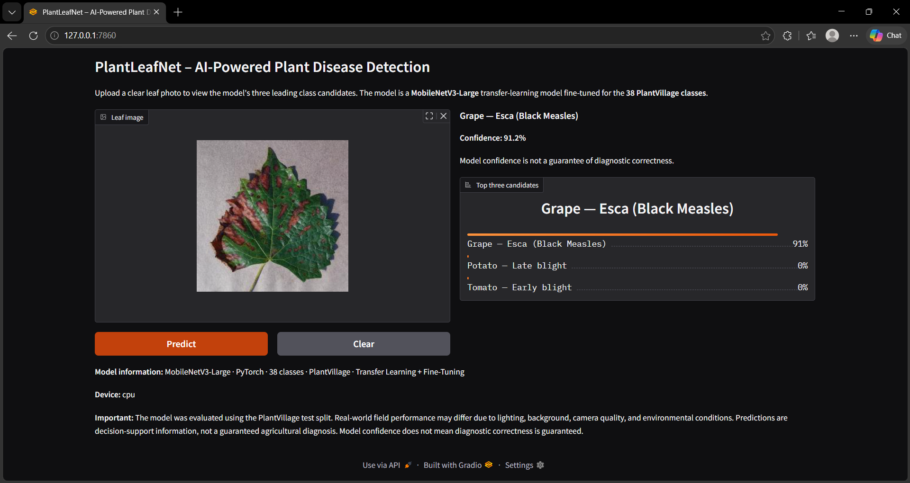

# 🌿 PlantLeafNet – Advanced Plant Disease Detection

An AI-powered plant disease classification system using **PyTorch, Transfer Learning, and Model Optimization**.

PlantLeafNet identifies plant diseases from leaf images using deep learning models trained and evaluated on the PlantVillage dataset. It includes a custom CNN baseline, two pretrained architectures, model comparison, explainability experiments, optimization, and an interactive Gradio application.

## 🚀 Project Overview

Plant diseases can significantly affect agricultural productivity. Early identification can help farmers and agricultural professionals make better-informed decisions.

PlantLeafNet explores image classification across **38 plant disease and healthy-leaf classes** using:

- Custom CNN trained from scratch.
- MobileNetV3-Large transfer learning and fine-tuning.
- EfficientNetV2-S transfer learning and fine-tuning.

MobileNetV3-Large was selected for the local application because it combines strong classification performance with a relatively small model size and fast inference.

## ✨ Features

- Classification across 38 classes.
- Transfer learning and selective fine-tuning.
- Custom CNN and weighted CNN baselines.
- Data augmentation and label smoothing.
- Stratified training, validation, and test splits.
- Per-class precision, recall, and F1-score.
- Confusion matrix and learning-curve analysis.
- Grad-CAM visualization.
- CPU and GPU inference benchmarking.
- Dynamic INT8 quantization experiment.
- Interactive Gradio application running locally.
- Top-three predictions and confidence scores.
- Configurable low-confidence warning.
- Diagnostic disclaimer for responsible use.

## 📊 Dataset

**PlantVillage Dataset**

Source: [PlantVillage Dataset – Kaggle](https://www.kaggle.com/datasets/abdallahalidev/plantvillage-dataset)

Dataset characteristics:

- Original color images: 54,305.
- Classes: 38.
- Image resolution: 256 × 256.
- The source dataset also provides grayscale and segmented image representations.
- This project uses the color image subset.

### Cleaning and splitting

- 22 duplicate images removed.
- Cleaned dataset: 54,283 images.
- Stratified split: 70% training, 15% validation, 15% testing.

| Split | Images |
|---|---:|
| Training | 37,998 |
| Validation | 8,142 |
| Testing | 8,143 |
| **Total** | **54,283** |

The original dataset is not included in this repository because of its size. Download it separately from Kaggle if you want to reproduce the training experiments.

## 🧠 Models Evaluated

| Model | Description |
|---|---|
| Custom CNN | CNN trained from scratch |
| Weighted CNN | CNN trained using class-weighted loss |
| MobileNetV3-Large | Pretrained model with transfer learning and fine-tuning |
| EfficientNetV2-S | Pretrained model with transfer learning and fine-tuning |

## 📈 Experimental Results

### Transfer-learning comparison

| Metric | MobileNetV3-Large | EfficientNetV2-S |
|---|---:|---:|
| Validation Accuracy | **98.92%** | 98.53% |
| Test Accuracy | **98.89%** | 98.46% |
| Macro Precision | **98.50%** | 97.92% |
| Macro Recall | **98.29%** | 97.70% |
| Macro F1-score | **98.39%** | 97.78% |
| Checkpoint Size | 16.42 MB | 78.03 MB |

MobileNetV3-Large was selected for the local application based on its combination of accuracy, model size, and measured inference speed.

### Model optimization

Dynamic quantization was experimentally applied to the linear layers of MobileNetV3-Large.

| Measurement | FP32 | Dynamic INT8 |
|---|---:|---:|
| Checkpoint Size | 16.41 MB | 12.76 MB |

**Checkpoint size reduction: 22.25%.**

The FP32 and quantized models produced matching predictions on one synthetic-input smoke test. Comprehensive real-image accuracy evaluation of the quantized model was not performed.

### Inference benchmarking

Measurements were obtained using Google Colab hardware and synthetic inputs.

| Model | Device | Batch Size | Batch Latency | Throughput |
|---|---|---:|---:|---:|
| MobileNetV3-Large | NVIDIA T4 | 32 | 21.54 ms | 1,485.61 images/sec |
| EfficientNetV2-S | NVIDIA T4 | 32 | 101.47 ms | 315.36 images/sec |
| MobileNetV3-Large | CPU | 8 | 154.73 ms | 51.70 images/sec |
| EfficientNetV2-S | CPU | 8 | 936.07 ms | 8.55 images/sec |

These measurements represent model-forward-pass benchmarks. They exclude image loading and preprocessing and are not complete application response times.

## 🌱 Application Demo

PlantLeafNet includes an interactive Gradio application that runs locally using the fine-tuned MobileNetV3-Large model.

Users can:

1. Upload a plant leaf image.
2. Run the trained classification model.
3. View the predicted class.
4. View the prediction confidence.
5. Explore the top-three candidate predictions.

A configurable confidence threshold is used to flag uncertain predictions.

The application supports CPU inference and displays a diagnostic disclaimer.

### Example Predictions

**Tomato – Late Blight (95.3%)**



**Potato – Healthy (94.8%)**



**Grape – Esca (91.2%)**



## 🔬 Explainability

Grad-CAM was implemented to visualize image regions contributing to a model prediction.

A sample Tomato Late Blight visualization is available at:

`results/gradcam/tomato_late_blight_gradcam.png`

Grad-CAM provides an approximate explanation of model behavior. It does not prove that the model relies exclusively on disease-related leaf features.

## 📓 Research Notebooks

The project is organized into six Jupyter notebooks, following the complete machine learning workflow.

| Notebook | Description |
|---|---|
| `01_dataset_exploration_preprocessing_cleaned.ipynb` | Dataset exploration, image quality analysis, duplicate detection, cleaning, and stratified train/validation/test splitting. |
| `02_cnn_baseline.ipynb` | Custom CNN baseline and class-weighted CNN experiments. |
| `03_transfer_learning.ipynb` | MobileNetV3-Large and EfficientNetV2-S transfer learning and fine-tuning. |
| `04_model_experiments.ipynb` | Training-curve analysis and comparative evaluation of the CNN and transfer-learning models. |
| `05_evaluation_explainability.ipynb` | Per-class evaluation, error analysis, and Grad-CAM explainability. |
| `06_model_optimization.ipynb` | CPU/GPU inference benchmarking and dynamic quantization experiments. |

## 🏗️ Project Structure

```text
PlantLeafNet/
│
├── app.py
├── requirements.txt
├── .gitignore
├── README.md
├── LICENSE
├── class_mapping.json
│
├── notebooks/
│   ├── 01_dataset_exploration_preprocessing_cleaned.ipynb
│   ├── 02_cnn_baseline.ipynb
│   ├── 03_transfer_learning.ipynb
│   ├── 04_model_experiments.ipynb
│   ├── 05_evaluation_explainability.ipynb
│   └── 06_model_optimization.ipynb
│
├── models/
│   ├── best_cnn_baseline.pth
│   ├── best_weighted_cnn.pth
│   ├── best_mobilenet_v3.pth
│   ├── best_mobilenet_finetuned.pth
│   ├── best_efficientnet_v2_s.pth
│   └── best_efficientnet_finetuned.pth
│
├── results/
│   ├── cnn_baseline_history.csv
│   ├── cnn_comparison.csv
│   ├── weighted_cnn_history.csv
│   ├── mobilenet_training_history.csv
│   ├── mobilenet_finetuning_history.csv
│   ├── mobilenet_test_classification_report.csv
│   ├── mobilenet_test_confusion_matrix.csv
│   ├── efficientnet_v2_s_history.csv
│   ├── efficientnet_finetuning_history.csv
│   ├── efficientnet_test_classification_report.csv
│   ├── efficientnet_test_confusion_matrix.csv
│   ├── final_evaluation_summary.csv
│   ├── inference_benchmark.csv
│   ├── model_checkpoint_sizes.csv
│   ├── model_validation_comparison.csv
│   ├── quantization_results.csv
│   └── gradcam/
│       └── tomato_late_blight_gradcam.png
│
├── screenshots/
│   ├── tomato_late_blight.png
│   ├── potato_healthy.png
│   └── grape_esca.png
│
└── splits/
    ├── train.csv
    ├── validation.csv
    └── test.csv
```

The local `.venv/` environment and `.git/` metadata are not part of the project structure shown above. The original PlantVillage dataset is not included; the `splits/` CSV files contain split manifests rather than the images themselves.

## ⚙️ Technology Stack

| Category | Technologies |
|---|---|
| Programming | Python |
| Deep Learning | PyTorch, Torchvision |
| Image Processing | Pillow |
| Data Processing | NumPy, Pandas |
| Visualization | Matplotlib, Seaborn |
| Evaluation | Scikit-learn |
| Explainability | Grad-CAM |
| Application | Gradio (local application) |
| Development | Google Colab, VS Code |

## 💻 Run Locally

### 1. Clone the repository

```bash
git clone https://github.com/Mr-Aswin/PlantLeafNet.git
cd PlantLeafNet
```

### 2. Create a virtual environment

Windows PowerShell:

```powershell
python -m venv .venv
.\.venv\Scripts\Activate.ps1
```

### 3. Install dependencies

```bash
pip install -r requirements.txt
```

For GPU inference, install a compatible CUDA-enabled PyTorch and Torchvision build using the [official PyTorch installation selector](https://pytorch.org/get-started/locally/).

### 4. Launch the application

```bash
python app.py
```

Open the local Gradio URL printed in the terminal, normally:

`http://127.0.0.1:7860`

## ⚠️ Limitations

- Evaluation was performed on a held-out PlantVillage test split containing 8,143 images.
- PlantVillage images have relatively controlled backgrounds and capture conditions.
- Real-world field images may differ in lighting, backgrounds, camera quality, leaf orientation, and disease severity.
- Independent field validation using datasets such as PlantDoc is still needed.
- Confidence scores do not guarantee diagnostic correctness.
- Dynamic quantization was not comprehensively evaluated for real-image accuracy.
- This project is an educational and research demonstration, not a replacement for expert agricultural diagnosis.

## 🔮 Future Improvements

- Evaluate using independent field-image datasets such as PlantDoc.
- Improve robustness under real-world lighting and backgrounds.
- Perform comprehensive quantized-model accuracy evaluation.
- Explore pruning and ONNX inference optimization.
- Investigate confidence calibration and uncertainty estimation.
- Extend the application with agricultural guidance and disease-management information.

## 👨‍💻 Author

**ASWIN S.**

B.Sc. Computer Science - Artificial Intelligence & Data Science

Interested in Machine Learning, Deep Learning, Computer Vision, and AI-powered applications.

---

*PlantLeafNet is an educational and research project exploring deep learning approaches to plant disease classification.*
